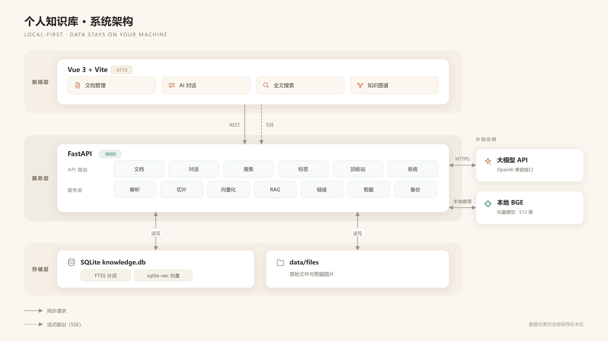

# 个人知识库系统 — 功能与架构设计文档

> 版本：v1.0
> 日期：2026-10-31
>
> 本文档描述**当前实现**，以代码为准。变更历史见 git 提交记录。

## 一、项目概述

### 1.1 项目定位

一个面向个人的本地知识库系统，核心能力：

- **文档存储**：支持 Markdown / PDF / Word 等格式，双版本存储（原始文件 + Markdown 文本）
- **AI 调用文档**：AI 能读取指定文档做总结/分析
- **AI 跨库问答（RAG）**：基于知识库内容的语义检索与问答
- **全文搜索**：基于 SQLite FTS5 的轻量级全文检索

### 1.2 设计原则

| 原则 | 说明 |
|------|------|
| **简单优先** | 零运维，单文件数据库，一个文件夹搞定 |
| **本地优先** | 数据全部存本地，不依赖云服务 |
| **安全底线** | API Key 不入代码，上传有校验，数据软删除 |
| **双版本存储** | 原始文件保真展示，Markdown 版本供 AI 和搜索 |
| **异步处理** | 解析/向量化不阻塞上传接口 |

### 1.3 技术栈

| 层 | 选型 | 说明 |
|----|------|------|
| 后端 | Python 3.11+ / FastAPI | 异步 IO，AI 生态完善 |
| 前端 | Vue 3 / Vite / Element Plus | SPA，纯本地运行 |
| 关系数据库 | SQLite 3（WAL） | 文档、切片、标签、会话、版本、链接 |
| 全文检索 | SQLite FTS5（trigram） | 中文子串匹配；1–2 字走 LIKE 兜底 |
| 向量检索 | sqlite-vec（vec0） | 与主库同文件，无额外服务 |
| Embedding | 本地 BGE-small-zh（512 维）/ OpenAI 兼容 API | `AI_EMBEDDING_MODEL=local` 即全本地 |
| LLM | OpenAI 兼容接口 | DeepSeek / OpenAI / 通义等 |
| 文档解析 | PyMuPDF、python-docx、html2text、readability-lxml | 按格式选解析器 |
| 前端渲染 | markdown-it + highlight.js + DOMPurify | 渲染并净化 |
| 可视化 | ECharts（统计）、d3-force（图谱） | 仪表盘与知识图谱 |
| 测试 | pytest | 纯函数用例，CI 不装模型 |

## 二、功能设计

### 2.1 功能清单

#### P0 — 核心必做

| 编号 | 功能 | 说明 |
|------|------|------|
| F01 | 文档上传 | 支持拖拽/点击上传，校验类型和大小（≤20MB） |
| F02 | 文档解析 | 自动提取文本，按格式转 Markdown |
| F03 | 双版本存储 | 原始文件存磁盘，Markdown 存数据库 |
| F04 | 文档列表 | 标题/时间/类型筛选，分页展示 |
| F05 | 文档查看 | 原始文件预览（PDF.js / Word 转图）+ Markdown 预览 |
| F06 | 全文搜索 | SQLite FTS5，标题 + 内容 + 标签，结果高亮 |
| F07 | 指定文档 AI 对话 | 用户选中文档，AI 读取内容做总结/问答 |
| F08 | 知识库 AI 问答（RAG） | 用户提问，AI 跨库检索相关片段回答，带引用来源 |
| F09 | 流式输出 | AI 回答 SSE 流式返回 |
| F10 | 软删除 | 标记删除，30 天后自动清理 |

#### P1 — 重要增强

| 编号 | 功能 | 说明 |
|------|------|------|
| F11 | 标签管理 | 多标签、标签树、按标签筛选 |
| F12 | 多轮对话 | 对话历史按会话保存，支持上下文连续问答 |
| F13 | 对话新建/切换 | 创建多个对话，按文档或主题分类 |
| F14 | 文档版本历史 | 每次编辑自动存版本，可查看和回退 |
| F15 | 手动编辑 Markdown | 修正解析错误的文档内容 |
| F16 | 自动备份 | 每天定时备份 SQLite + files 目录 |
| F17 | 异步解析 | 上传立即返回，后台处理解析+向量化 |

#### P2 — 锦上添花

| 编号 | 功能 | 说明 |
|------|------|------|
| F18 | 文档自动摘要 | AI 自动为新文档生成摘要 |
| F19 | 知识图谱 | 可视化文档间关联 |
| F20 | 统计面板 | 文档数、标签云、活跃时间段 |
| F21 | 网页剪藏 | 浏览器扩展一键保存网页 |
| F22 | 快捷键 | 全局搜索、新建文档快捷键 |

### 2.2 功能交互流程

#### 流程一：文档上传与入库

```
用户上传文件
    │
    ├── 校验：类型白名单 + 大小 ≤20MB
    ├── 重命名：uuid + 扩展名（防路径穿越）
    ├── 存原始文件 → data/files/uuid.pdf
    ├── 写入数据库：status=processing
    │
    └── 后台异步任务：
         │
         ├── 解析器 → Markdown 文本
         │    ├── PDF  → PyMuPDF
         │    ├── Word → python-docx
         │    ├── HTML → html2text
         │    └── MD   → 直接存
         │
         ├── 更新 content_md + parse_status
         ├── 语义切片（按标题/段落，重叠1-2句）
         ├── 调用 Embedding API 生成向量
         ├── 向量存入 sqlite-vec
         └── 更新 status=ready
```

#### 流程二：RAG 知识库问答

```
用户输入问题
    │
    ├── 可选：指定某篇文档 → 跳过检索直接用该文档
    │
    ├── Embedding API → 问题向量
    ├── sqlite-vec 相似度检索 → top-5 相关片段
    │
    ├── 组装 Prompt：
    │    System: 你是知识库助手，基于提供的文档内容回答...
    │    Context: 文档A片段1 + 文档B片段2 + ...
    │    Question: 用户问题
    │    Rule: 回答末尾标注引用来源 [来源：xxx]
    │
    ├── 调用 LLM（SSE 流式）
    ├── 逐 chunk 返回给前端
    └── 保存对话历史
```

#### 流程三：指定文档 AI 对话

```
用户选中文档 + 输入问题
    │
    ├── 取文档 content_md（Markdown 版本）
    ├── 若文档过长 → 切片 + 检索相关片段（同 RAG）
    ├── 组装 Prompt（加上文档标题）
    ├── 调用 LLM（SSE 流式）
    └── 保存对话历史（关联 document_id）
```

---

## 三、架构设计

### 3.1 整体架构图



> 前端只通过 REST / SSE 访问后端；文档、切片、向量索引与原始文件全部保存在本机。
> 源文件是矢量图 [`docs/architecture.svg`](docs/architecture.svg)，改图后重新导出 PNG 即可。

### 3.2 项目目录结构

```
知识库/
├── backend/
│   ├── main.py                 # 入口：lifespan 启动任务 + 静态文件 + CORS
│   ├── config.py               # pydantic-settings 读取 .env
│   ├── api/                    # 路由层
│   │   ├── documents.py        # 上传/CRUD/解析/索引/剪藏/版本
│   │   ├── search.py           # FTS5 trigram 检索
│   │   ├── chat.py             # 三种对话模式 + SSE + 导出/重新生成
│   │   ├── tags.py             # 标签 CRUD
│   │   ├── trash.py            # 回收站（恢复/彻底删除/批量）
│   │   ├── graph.py            # 知识图谱数据
│   │   ├── stats.py            # 概览统计 + 连通性测试
│   │   └── system.py           # 设置读写 + 备份管理
│   ├── services/
│   │   ├── parser.py           # 解析器插件
│   │   ├── chunker.py          # 语义切片
│   │   ├── embedding.py        # 本地 BGE / API Embedding
│   │   ├── vec_store.py        # sqlite-vec 封装 + 写锁
│   │   ├── fts_sync.py         # FTS 索引同步
│   │   ├── llm.py              # OpenAI 兼容流式客户端（支持热更新）
│   │   ├── rag.py              # 检索 + Prompt 组装 + 长文档片段检索
│   │   ├── links.py            # 双向链接：提取/全量/增量/合并调度
│   │   ├── clipper.py          # 网页正文提取 + 图片本地化
│   │   ├── autotag.py          # AI 自动打标签
│   │   ├── tags_usage.py       # 标签计数重算
│   │   └── backup.py           # SQLite 在线备份
│   ├── db/
│   │   ├── database.py         # 引擎、WAL、FTS/向量表初始化与迁移
│   │   ├── models.py           # ORM 模型
│   │   └── schemas.py          # Pydantic Schema
│   └── utils/
│       ├── security.py         # 文件校验 / uuid 重命名
│       └── loop_lock.py        # 按事件循环取 asyncio.Lock
│
├── frontend/
│   ├── package.json / vite.config.js / index.html
│   └── src/
│       ├── App.vue / main.js / theme.js
│       ├── api/index.js        # 所有接口封装
│       ├── router/index.js     # 7 个页面路由
│       ├── utils/tagColor.js   # 标签稳定取色
│       └── views/              # Dashboard / Documents / Chat / Search / Graph / Trash / Settings
│
├── docs/                       # 架构图（SVG + PNG）
├── tests/                      # pytest 单元测试（纯函数，不依赖模型）
├── .github/workflows/ci.yml    # CI
├── data/                       # 运行时数据（.gitignore）
├── backup/                     # 备份目录（.gitignore）
├── .env / .env.example
└── DESIGN.md
```

### 3.3 关键设计决策

#### 3.3.1 文档解析插件式架构

```python
# backend/services/parser.py

class BaseParser(ABC):
    @abstractmethod
    def parse(self, file_path: str) -> str:
        """返回 Markdown 文本"""
        pass

class MarkdownParser(BaseParser): ...
class PDFParser(BaseParser): ...
class DocxParser(BaseParser): ...
class HTMLParser(BaseParser): ...

PARSERS: dict[str, BaseParser] = {
    ".md": MarkdownParser(),
    ".pdf": PDFParser(),
    ".docx": DocxParser(),
    ".html": HTMLParser(),
}

def parse(file_path: str, ext: str) -> str:
    parser = PARSERS.get(ext.lower())
    if not parser:
        raise UnsupportedFormat(f"不支持的格式: {ext}")
    return parser.parse(file_path)
```

#### 3.3.2 文本切片策略

```python
# backend/services/chunker.py

def chunk_markdown(content: str, max_size: int = 800, overlap: int = 100) -> list[Chunk]:
    """
    按标题/段落切分，确保每个片段语义完整。
    相邻片段 overlap 字符重叠，避免切断上下文。
    每个 chunk 携带所属文档标题和章节路径。
    """
```

切片示例：

```
文档：FastAPI 教程
├── [Chunk 1] title=FastAPI 教程 > 第一章 概述
│    内容：FastAPI 是一个现代化的 Python Web 框架...（末尾 100 字符重叠给 Chunk 2）
├── [Chunk 2] title=FastAPI 教程 > 第一章 概述 > 1.1 安装
│    内容：...（前 100 字符来自 Chunk 1 末尾）首先需要安装 Python 3.7+...
└── ...
```

#### 3.3.3 RAG Prompt 模板

```
System: 你是一个知识库助手。请严格基于下方提供的文档内容回答用户问题。
        如果文档中没有相关内容，请明确说明"知识库中未找到相关信息"，不要编造答案。
        在回答末尾标注引用来源，格式：[来源：文档标题]

Context:
[文档A] FastAPI 是一个现代化...
[文档B] Python 异步编程的核心是...

Question: 用户的问题

Answer:
```

#### 3.3.4 流式输出（SSE）

```python
# backend/api/chat.py
from fastapi.responses import StreamingResponse

async def chat_stream(request: ChatRequest):
    async def generate():
        async for chunk in llm.stream(prompt):
            yield f"data: {chunk}\n\n"
        yield "data: [DONE]\n\n"
    return StreamingResponse(generate(), media_type="text/event-stream")
```

---

#### 3.3.5 并发与锁模型

SQLite 是单写者模型，本项目用三层机制避免写冲突和数据错乱：

| 层 | 机制 | 作用 |
|----|------|------|
| 连接层 | WAL 模式 + `timeout=30` + `_with_retry` | 写等待与短暂重试，避免 `database is locked` |
| 原生 sqlite3 写 | 进程内 `threading.Lock`（`vec_store.db_write_lock`） | 串行化向量表 / FTS 的写入（这些调用跑在 `asyncio.to_thread` 里，不阻塞事件循环） |
| 业务级 | `loop_lock("links_rebuild")`、`loop_lock(f"index:{doc_id}")` | 链接重建互斥；同一文档的索引重建串行 |

**为什么需要 `loop_lock`**：`threading.Lock` 如果在 `async` 函数里跨 `await` 持有，
第二个协程会阻塞事件循环线程，导致持锁协程永远无法恢复（死锁）；
而模块级 `asyncio.Lock()` 在同一进程的多个事件循环里复用会报
"bound to a different event loop"。所以按「事件循环 + 名字」取锁，见 `utils/loop_lock.py`。

**索引写入为什么必须按文档串行**：重建流程是「删 chunk → 插 chunk → 插向量」，
SQLite 会复用被删掉的最大 rowid，两个并发任务拿到相同 chunk id 就会撞
`chunk_embeddings` 主键，表现为向量索引静默丢失。

#### 3.3.6 后台任务与索引一致性

| 动作 | 同步部分 | 后台部分 |
|------|----------|----------|
| 上传 | 校验、落盘、解析、写库、FTS | 切片 + 向量化 → 摘要 → 自动标签 |
| 编辑正文 | 写库、版本快照、FTS | 向量化 → 摘要（不阻塞保存） |
| 批量重建索引 | 立即返回 | 逐篇重建，完成后刷新可见 |
| 链接重建 | — | 全量或按文档增量，请求会合并 |
| 启动 | 建表/迁移、WAL | 备份、链接重建、标签计数校正、模型预热 |

- 软删除只清理 FTS，**保留** chunk 与向量，恢复时无需重建；彻底删除才清理。
- RAG 检索在 SQL 层过滤 `is_deleted`，并多召回一些再截断，避免删除文档占用名额。
- 版本历史每篇保留最近 **30** 份。
- 标签 `usage_count` 是冗余字段，所有关联变更后统一重算（`services/tags_usage.py`）。

#### 3.3.7 几个关键取舍

- **全文索引用 trigram 而不是 unicode61**：unicode61 会把整段中文当成一个 token，
  只能整词命中；trigram 按 3 字滑窗索引，天然支持中文子串匹配。代价是索引更大，
  且 1–2 字的词检索不生效，所以短词走 `LIKE` 兜底。
- **向量表用原生 `sqlite3` 连接创建**：`aiosqlite` 的代理连接上 `enable_load_extension`
  不可用，会报 `no such module: vec0`；建表、写入、检索都走原生连接，放在
  `asyncio.to_thread` 里执行，不阻塞事件循环。
- **Markdown 一律先净化再渲染**：文档内容可能来自网页剪藏或手动编辑，前端统一经
  `DOMPurify` 处理后才能 `v-html`。
- **本地模型不可用时不阻塞主流程**：Embedding 失败时检索退化为关键词匹配；
  未配置 API Key 时只关闭 AI 对话/摘要/自动标签，上传、搜索、标签等能力照常。

## 四、数据库设计

### 4.1 表结构

```sql
-- ==================== 文档 ====================
CREATE TABLE documents (
    id              INTEGER PRIMARY KEY AUTOINCREMENT,
    title           TEXT NOT NULL,
    file_path       TEXT,                    -- files/uuid.pdf；剪藏与在线创建为 NULL
    content_md      TEXT,                    -- Markdown 版本（AI + 搜索用）
    file_type       TEXT,                    -- md / txt / pdf / docx / html / clip
    file_size       INTEGER DEFAULT 0,
    parse_status    TEXT DEFAULT 'pending',  -- pending/processing/success/partial/failed
    summary         TEXT,                    -- AI 自动摘要
    word_count      INTEGER DEFAULT 0,       -- 实际存的是字符数
    source_url      TEXT,                    -- 网页剪藏来源（旧库启动时自动 ALTER 添加）
    is_deleted      INTEGER DEFAULT 0,
    deleted_at      DATETIME,
    created_at      DATETIME,
    updated_at      DATETIME
);

-- ==================== 版本历史（每篇保留最近 30 份）====================
CREATE TABLE document_versions (
    id              INTEGER PRIMARY KEY AUTOINCREMENT,
    document_id     INTEGER NOT NULL REFERENCES documents(id),
    content_md      TEXT,
    version_note    TEXT,                    -- 初始版本 / 自动保存 / 重新解析 / 回滚到版本 #n
    created_at      DATETIME
);

-- ==================== 标签 ====================
CREATE TABLE tags (
    id              INTEGER PRIMARY KEY AUTOINCREMENT,
    name            TEXT UNIQUE NOT NULL,
    color           TEXT DEFAULT '#666666',
    usage_count     INTEGER DEFAULT 0        -- 冗余字段，写操作后整体重算
);

CREATE TABLE document_tags (
    document_id     INTEGER NOT NULL REFERENCES documents(id) ON DELETE CASCADE,
    tag_id          INTEGER NOT NULL REFERENCES tags(id) ON DELETE CASCADE,
    PRIMARY KEY (document_id, tag_id)
);

-- ==================== 切片 ====================
CREATE TABLE chunks (
    id              INTEGER PRIMARY KEY AUTOINCREMENT,
    document_id     INTEGER NOT NULL REFERENCES documents(id) ON DELETE CASCADE,
    chunk_index     INTEGER NOT NULL,
    content         TEXT NOT NULL,
    section_path    TEXT,                    -- 章节路径：第一章 > 1.1
    token_count     INTEGER DEFAULT 0,       -- 实际存的是字符数
    created_at      DATETIME
);

-- ==================== 对话 ====================
CREATE TABLE conversations (
    id              INTEGER PRIMARY KEY AUTOINCREMENT,
    title           TEXT,
    mode            TEXT DEFAULT 'rag',      -- rag / direct / doc
    document_id     INTEGER REFERENCES documents(id),
    created_at      DATETIME,
    updated_at      DATETIME
);

CREATE TABLE messages (
    id              INTEGER PRIMARY KEY AUTOINCREMENT,
    conversation_id INTEGER NOT NULL REFERENCES conversations(id) ON DELETE CASCADE,
    role            TEXT NOT NULL,           -- user / assistant
    content         TEXT NOT NULL,
    sources         TEXT,                    -- JSON：RAG 引用的片段
    created_at      DATETIME
);

-- ==================== 双向链接 ====================
CREATE TABLE document_links (
    id              INTEGER PRIMARY KEY AUTOINCREMENT,
    from_doc_id     INTEGER NOT NULL REFERENCES documents(id) ON DELETE CASCADE,
    to_doc_id       INTEGER NOT NULL REFERENCES documents(id) ON DELETE CASCADE,
    source          TEXT DEFAULT 'auto',     -- auto（标题匹配）/ syntax（[[标题]]）
    created_at      DATETIME,
    UNIQUE (from_doc_id, to_doc_id)
);

CREATE INDEX ix_document_links_from_doc_id ON document_links(from_doc_id);
CREATE INDEX ix_document_links_to ON document_links(to_doc_id);

-- ==================== 全文索引（trigram 分词，手工同步）====================
CREATE VIRTUAL TABLE documents_fts USING fts5(
    title,
    content_md,
    tokenize='trigram'
);
```

> 除主键与 `document_links` 的索引外，其余表依赖 SQLite 的 rowid/唯一约束。
> 个人库规模（千篇以内）足够；再大建议补 `documents(is_deleted, created_at)`、
> `chunks(document_id)`、`messages(conversation_id)` 等索引。

### 4.2 sqlite-vec 向量存储

与主库同一个文件，不额外生成数据库：

```sql
CREATE VIRTUAL TABLE chunk_embeddings USING vec0(
    rowid        INTEGER PRIMARY KEY,   -- 等于 chunks.id
    document_id  INTEGER,               -- 便于按文档删除/统计
    embedding    float[512]             -- 维度 = VECTOR_DIM，本地 BGE-small 默认 512
);

-- 写入：rowid 即 chunk id
INSERT INTO chunk_embeddings(rowid, document_id, embedding) VALUES (?, ?, ?);

-- 检索：L2 距离升序
SELECT rowid, document_id, distance FROM chunk_embeddings
WHERE embedding MATCH ? ORDER BY distance LIMIT 20;
```

维度必须与 `VECTOR_DIM` 一致：启动时会读取现有向量维度校验，不一致则重建向量表
（需要再执行一次「重建索引」）。`vec0` 虚拟表只能用原生 `sqlite3` 连接创建，
`aiosqlite` 的代理连接无法加载扩展。

## 五、API 设计

### 5.1 统一响应格式

```json
// 成功
{ "code": 0, "data": { ... }, "msg": "ok" }

// 失败
{ "code": 4001, "data": null, "msg": "文件格式不支持" }
```

### 5.2 文档与索引

| 方法 | 路径 | 说明 |
|------|------|------|
| POST | /api/documents/upload | 上传文档（multipart/form-data） |
| GET | /api/documents | 文档列表（分页、标题筛选） |
| GET | /api/documents/{id} | 文档详情 |
| GET | /api/documents/{id}/preview | Markdown 内容 |
| GET | /api/documents/{id}/raw | 下载原始文件 |
| PUT | /api/documents/{id} | 更新标题 / Markdown（后台重建索引） |
| DELETE | /api/documents/{id} | 软删除 |
| POST | /api/documents/{id}/restore | 从软删除恢复 |
| POST | /api/documents/batch-delete | 批量软删除 |
| POST | /api/documents/{id}/reparse | 重新解析（需有原始文件） |
| POST | /api/documents/{id}/reindex | 重建单篇向量索引 |
| POST | /api/documents/reindex-all | 批量重建（**后台执行，立即返回**） |
| POST | /api/documents/create-text | 在线新建 Markdown 文档 |
| POST | /api/documents/clip | 网页剪藏（url 或 html） |
| GET | /api/documents/{id}/links | 双向链接（outgoing / incoming） |
| GET | /api/documents/{id}/versions | 版本历史 |
| GET | /api/documents/{id}/versions/{v_id} | 版本内容 |
| POST | /api/documents/{id}/versions/{v_id}/restore | 回滚到指定版本 |

### 5.3 标签

| 方法 | 路径 | 说明 |
|------|------|------|
| GET | /api/tags | 所有标签（按使用次数排序） |
| POST | /api/tags | 新建标签（空名/重名返回 400） |
| PUT | /api/tags/{id} | 重命名 / 改色 |
| DELETE | /api/tags/{id} | 删除标签 |
| POST | /api/tags/document/{doc_id} | 给文档加标签（body 为标签名数组） |
| DELETE | /api/tags/document/{doc_id}/{tag_id} | 移除标签 |

### 5.4 搜索与图谱

| 方法 | 路径 | 说明 |
|------|------|------|
| GET | /api/search?q=&page=&page_size= | 全文搜索，返回高亮片段与 rank |
| GET | /api/graph | 图谱节点（含标签）与边（含来源类型） |

### 5.5 对话

| 方法 | 路径 | 说明 |
|------|------|------|
| GET | /api/conversations | 会话列表 |
| POST | /api/conversations | 新建会话（mode: rag/direct/doc） |
| GET | /api/conversations/{id} | 会话详情 + 消息 |
| PUT | /api/conversations/{id} | 修改标题 / 模式 |
| DELETE | /api/conversations/{id} | 删除会话 |
| GET | /api/conversations/{id}/export | 导出为 Markdown |
| POST | /api/conversations/{id}/regenerate/{msg_id} | 重新生成某条回答 |
| POST | /api/chat/direct | 纯 AI 对话（SSE） |
| POST | /api/chat/stream | 指定文档问答（SSE） |
| POST | /api/chat/rag | 知识库 RAG 问答（SSE） |

### 5.6 系统

| 方法 | 路径 | 说明 |
|------|------|------|
| GET / PUT | /api/settings | 读取 / 写入配置（写 .env 并热更新） |
| POST | /api/backup | 立即备份 |
| GET | /api/backups | 备份列表 |
| DELETE | /api/backups/{name} | 删除备份 |
| GET | /api/trash | 回收站列表 |
| POST | /api/trash/{id}/restore | 恢复 |
| DELETE | /api/trash/{id} | 彻底删除（含文件、向量、版本） |
| POST | /api/trash/batch-restore | 批量恢复 |
| POST | /api/trash/batch-purge | 批量彻底删除 |
| GET | /api/stats/overview | 概览统计 |
| POST | /api/stats/test-llm | AI 连通性测试 |
| GET | /api/health | 健康检查 |

### 5.7 对话请求体示例

```json
// 指定文档对话
{ "conversation_id": 1, "document_id": 42, "message": "这篇文档的核心观点是什么？" }

// RAG 知识库问答
{ "conversation_id": null, "message": "FastAPI 和 Flask 有什么区别？", "top_k": 5 }

// 纯 AI 对话
{ "conversation_id": 3, "message": "帮我写个正则" }
```

## 六、配置说明

### 6.1 .env 文件

```env
# AI 接口
AI_API_KEY=sk-xxxxxxxxxxxxxxxx
AI_BASE_URL=https://api.openai.com/v1
AI_MODEL=gpt-4o-mini
AI_EMBEDDING_MODEL=text-embedding-3-small
VECTOR_DIM=1536

# 本地 Embedding（推荐，免费；把上面两行换成这两行）
# AI_EMBEDDING_MODEL=local
# VECTOR_DIM=512

# 数据库 / 文件存储
DB_PATH=data/knowledge.db
FILE_STORAGE_DIR=data/files
MAX_FILE_SIZE=20971520
ALLOWED_EXTENSIONS=.md,.txt,.pdf,.docx,.html

# 备份
BACKUP_DIR=backup
BACKUP_KEEP_DAYS=7

# 本地模型下载（首次约 100MB）
HF_ENDPOINT=https://hf-mirror.com
BGE_OFFLINE=0
```

### 6.2 兼容国产模型

只需修改 AI 相关配置即可，无需改代码：

```env
# 通义千问
AI_BASE_URL=https://dashscope.aliyuncs.com/compatible-mode/v1
AI_MODEL=qwen-plus
AI_EMBEDDING_MODEL=text-embedding-v3
VECTOR_DIM=1024

# DeepSeek（对话）+ 本地 Embedding（DeepSeek 不提供 embedding 接口）
AI_BASE_URL=https://api.deepseek.com
AI_MODEL=deepseek-v4-flash
AI_EMBEDDING_MODEL=local
VECTOR_DIM=512
```

---

## 七、后续规划

核心能力已全部落地，能力清单见 README。后续可选方向：

- 全文检索与向量检索的混合排序（RRF），提升召回质量
- 移动端适配

## 八、风险与应对

| 风险 | 影响 | 应对 |
|------|------|------|
| PDF 是扫描件 | 无法提取文本 | 标记 `parse_status=failed`，允许手动补 Markdown |
| LLM 上下文超限 | 长文档问答不完整 | 超过 12000 字的文档改为库内切片检索，只送最相关片段 |
| Embedding 模型切换 | 维度不兼容 | 启动校验维度并重建向量表，再执行「重建索引」 |
| 并发保存 | 索引错乱/丢失 | 按文档串行化索引写入 + 版本快照 |
| 并发重建链接 | 事件循环死锁 | 事件循环锁 + 请求合并 |
| 本地模型不可用 | 语义检索失效 | 启动预热有超时；失败时降级为关键词匹配 |
| 文件上传 | 路径穿越 / 恶意文件 | 扩展名白名单 + uuid 重命名 + 大小限制 |
| 数据丢失 | 灾难性 | 启动自动备份 + 软删除 + 版本历史 |
| 局域网暴露 | 无鉴权可被读写 | 默认只监听 127.0.0.1；CORS 收紧到本地前端 |
| API Key 泄露 | 费用风险 | `.env` 管理且已被 `.gitignore` 忽略 |
