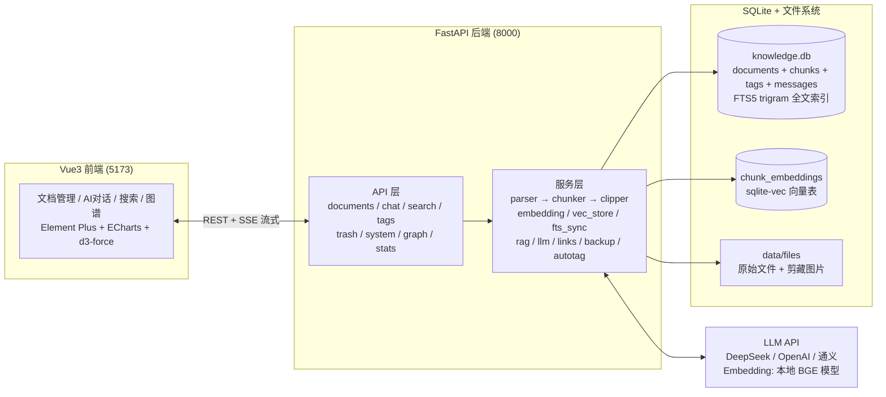

# 📚 个人知识库

一个面向个人的**本地**知识库系统：把散落在各处的 Markdown、PDF、Word、网页剪藏统一收进一个 SQLite 数据库，用全文检索和向量语义检索找回内容，并让 AI 基于**你自己的文档**回答问题。

> **数据完全在本地。** 数据库、原始文件、向量索引都存放在项目目录下。只有在发起 AI 对话时，才会把检索到的相关片段发送给你自己配置的模型接口（也可以换成任意 OpenAI 兼容的本地模型服务）。

## 📖 目录

- [功能特性](#-功能特性)
- [技术栈](#-技术栈)
- [系统架构](#-系统架构)
- [快速开始](#-快速开始)
- [配置项参考](#-配置项参考)
- [项目结构](#-项目结构)
- [网页剪藏](#-网页剪藏)
- [API 速查](#-api-速查)
- [常见问题](#-常见问题)
- [数据与隐私](#-数据与隐私)
- [多机同步](#-多机同步)
- [迭代路线](#-迭代路线)
- [License](#-license)

## ✨ 功能特性

| 功能 | 说明 |
|------|------|
| 📥 文档上传 | 支持 Markdown / PDF / Word / TXT / HTML，拖拽上传 |
| 💾 双版本存储 | 原始文件保留保真 + Markdown 版本供 AI/搜索使用 |
| 🔍 全文搜索 | SQLite FTS5 trigram 分词，中文子串匹配 + 结果高亮 |
| 🤖 AI 对话 | 指定文档问答 + 知识库 RAG 跨库检索 |
| 💬 流式输出 | SSE 逐字返回，体验丝滑 |
| 🏷️ 标签管理 | 多标签分类，自动配色（按名称稳定取色，暗色适配） |
| 🤖 AI 自动打标签 | 上传/编辑后 AI 自动生成 1-5 个标签 |
| 📝 手动编辑 | 解析错了？直接手动修正 Markdown |
| 🔄 版本历史 | 每次修改自动存档，可预览、可回滚 |
| 🗑️ 回收站 | 软删除 + 恢复 + 彻底清除 |
| 🔗 双向链接 | 正文提到其他文档标题自动关联，`[[标题]]` 显式链接，互相可见 |
| 🕸️ 知识图谱 | 文档关联网络可视化，可拖拽/缩放，点击直达文档 |
| 🌐 网页剪藏 | 粘贴网址或一键书签剪藏网页，自动转 Markdown 入库 |
| 📝 AI 自动摘要 | 上传后后台自动生成文档摘要 |
| 🎨 笔记风界面 | 暖白笔记风设计，卡片/列表视图切换，暗色模式（亮/暗/跟随系统） |
| 💾 自动备份 | 启动时自动备份数据库+文件，保留 N 天，可手动触发 |
| ⚙️ 设置热更新 | 在网页改 AI 配置即时生效，无需重启 |
| 🔌 多模型兼容 | OpenAI / 通义千问 / DeepSeek 等 |

## 🛠️ 技术栈

- **后端**：Python 3.11+ / FastAPI / SQLAlchemy / SQLite + FTS5 + sqlite-vec
- **前端**：Vue 3 / Vite / Element Plus / markdown-it
- **AI**：OpenAI 兼容接口（GPT / 通义 / DeepSeek）

## 🏗️ 系统架构



**核心链路：**

- **全文检索**：文档入库 → FTS5 trigram 索引 → `MATCH` + `LIKE` 混合查询 → 高亮片段
- **RAG 问答**：提问 → BGE 向量化 → sqlite-vec 语义检索 top-k → 上下文拼装 → LLM 流式生成（SSE）→ 引用溯源
- **双向链接**：正文自动标题匹配 + `[[语法]]` 显式链接 → 图谱数据 → d3-force 可视化
- **网页剪藏**：抓取/直传 → 噪声清洗 → readability 正文提取 → 图片本地化 → Markdown 入库

## 🚀 快速开始

### 环境准备

| 依赖 | 版本要求 | 说明 |
|------|----------|------|
| **Python** | 3.11 / 3.12 | 不要用 3.13+，部分依赖尚无预编译轮子 |
| **Node.js** | 18+ | 建议装 LTS 版 |


### 第一步：克隆项目

```bash
git clone https://github.com/Menorial/knowledge-base.git
cd knowledge-base
```
### 第二步：配置 AI 接口

```bash
# 复制模板
cp .env.example .env          # Windows 用：copy .env.example .env

# 编辑 .env，填入你的 API Key
```

```env
# DeepSeek（推荐，Embedding 用本地 BGE 模型，免费）
AI_API_KEY=sk-xxx
AI_BASE_URL=https://api.deepseek.com
AI_MODEL=deepseek-v4-flash
AI_EMBEDDING_MODEL=local   # 本地 BGE-small 模型，无需 API Key
VECTOR_DIM=512

# OpenAI
# AI_BASE_URL=https://api.openai.com/v1
# AI_MODEL=gpt-4o-mini
# AI_EMBEDDING_MODEL=text-embedding-3-small
# VECTOR_DIM=1536

# 通义千问
# AI_BASE_URL=https://dashscope.aliyuncs.com/compatible-mode/v1
# AI_MODEL=qwen-plus
# AI_EMBEDDING_MODEL=text-embedding-v3
# VECTOR_DIM=1024
```

> 💡 配置也可以在网页「设置」页修改，保存后即时生效，无需重启后端。

### 第三步：安装后端依赖

```bash
cd <项目根目录>
pip install -r backend/requirements.txt
```

> 首次安装会下载 `torch`（数百 MB），耐心等待；国内网络慢的话先按上文「环境准备」换源。

### 第四步：启动后端

> ⚠️ **必须在项目根目录下执行。** 代码里的导入路径是 `backend.xxx`，
> 在 `backend/` 子目录里启动会报 `Could not import module "backend.main"`。

```bash
cd <项目根目录>
python -m uvicorn backend.main:app --host 0.0.0.0 --port 8000 --reload
```

启动时会自动创建数据库、加载向量模型并做一次备份，日志出现
`Uvicorn running on http://0.0.0.0:8000` 即成功。访问 <http://localhost:8000/docs> 查看 API 文档。

### 第五步：启动前端

```bash
cd frontend
npm install
npm run dev
```

浏览器打开 <http://localhost:5173> 即可使用。

> 前端通过 `vite.config.js` 把 `/api`、`/files` 代理到 `http://localhost:8000`，
> **所以后端必须先启动**，否则页面能打开但所有接口都会失败。

### 手动启动（Windows，两个终端）

```powershell
# 终端 1 — 后端（必须在项目根目录）
cd <项目根目录>
python -m uvicorn backend.main:app --host 0.0.0.0 --port 8000 --reload

# 终端 2 — 前端
cd <项目根目录>\frontend
npm run dev
```

### 启动报错排查

**症状：敲完 `python -m uvicorn ...` 没有任何输出，直接回到提示符。**

Windows 的「应用执行别名」会把 `python` 指向
`C:\Users\<用户名>\AppData\Local\Microsoft\WindowsApps\python.exe` —— 一个假的可执行文件，
它不报错、不打印任何东西，直接以退出码 9009 结束。先用这条命令确认：

```powershell
where.exe python
```

如果第一行是 `...\WindowsApps\python.exe`，就是中招了。任选一种解决：

1. 设置 → 应用 → 高级应用设置 → 应用执行别名 → 关掉 `python.exe` 和 `python3.exe`；
2. 不关别名也行，改用 Python 的**绝对路径**调用，例如 `C:\Python311\python.exe -m uvicorn ...`；
3. 或者把 `python` 换成 `py`（Windows 自带的 Python 启动器，不受该别名影响）。

> 注意 `pip` 没有对应的别名，所以会出现「`pip install` 一路正常、`python` 却毫无反应」的假象。

**症状：`Error loading ASGI app. Could not import module "backend.main"`。**

工作目录不对，必须在项目根目录启动，见「第四步」。

**症状：SQLAlchemy 报 `The SQLAlchemy asyncio module requires that the Python 'greenlet' library is available`。**

`greenlet` 是 SQLAlchemy 异步扩展的必需依赖，但 pip 在 Windows 上不会自动带上。直接补装：

```bash
pip install greenlet
```

**症状：日志出现 `Embedding 模型加载失败`，语义检索不可用。**

首次使用会从 HuggingFace 下载 `BAAI/bge-small-zh-v1.5`（约 100MB）。代码里已默认走国内镜像
`HF_ENDPOINT=https://hf-mirror.com`，网络正常时会自动下载。若仍失败，可手动把模型放到
`~/.cache/modelscope/models/BAAI--bge-small-zh-v1.5/snapshots/master`，代码会优先读这个本地目录。

## ⚙️ 配置项参考

所有配置都写在项目根目录的 `.env` 文件里（从 `.env.example` 复制而来）。
**也可以直接在网页「设置」页修改，保存后即时生效，无需重启后端。**

### AI 接口

| 变量 | 默认值 | 说明 |
|------|--------|------|
| `AI_API_KEY` | 空 | API Key。留空时 AI 对话 / 摘要 / 自动打标签不可用，但上传、搜索、备份等功能不受影响 |
| `AI_BASE_URL` | `https://api.openai.com/v1` | OpenAI 兼容的接口地址 |
| `AI_MODEL` | `gpt-4o-mini` | 对话模型 |
| `AI_EMBEDDING_MODEL` | `text-embedding-3-small` | 向量模型。填 `local` 则使用**本地 BGE 模型**，免费且无需 API Key |
| `VECTOR_DIM` | `512` | 向量维度，**必须与所选 Embedding 模型的输出维度一致** |

**常见服务组合：**

| 服务 | `AI_BASE_URL` | `AI_MODEL` | `AI_EMBEDDING_MODEL` | `VECTOR_DIM` |
|------|---------------|------------|----------------------|--------------|
| DeepSeek（推荐） | `https://api.deepseek.com` | `deepseek-v4-flash` | `local` | `512` |
| OpenAI | `https://api.openai.com/v1` | `gpt-4o-mini` | `text-embedding-3-small` | `1536` |
| 通义千问 | `https://dashscope.aliyuncs.com/compatible-mode/v1` | `qwen-plus` | `text-embedding-v3` | `1024` |

> ⚠️ 修改 `VECTOR_DIM` 后，启动时会自动重建向量表，之后需再到「文档管理」页点一次「一键重建全部索引」。

### 存储与备份

| 变量 | 默认值 | 说明 |
|------|--------|------|
| `DB_PATH` | `data/knowledge.db` | SQLite 数据库路径 |
| `FILE_STORAGE_DIR` | `data/files` | 原始文件与剪藏图片的存储目录 |
| `MAX_FILE_SIZE` | `20971520`（20MB） | 单文件上传大小上限（单位：字节） |
| `ALLOWED_EXTENSIONS` | `.md,.txt,.pdf,.docx,.html` | 允许上传的文件类型 |
| `BACKUP_DIR` | `backup` | 自动备份目录 |
| `BACKUP_KEEP_DAYS` | `7` | 备份保留天数 |

### 其他环境变量

| 变量 | 默认值 | 说明 |
|------|--------|------|
| `HF_ENDPOINT` | `https://hf-mirror.com` | HuggingFace 镜像地址，首次下载 BGE 模型时使用 |
| `BGE_OFFLINE` | `0` | 设为 `1` 时只读本地模型缓存，不联网下载 |

## 📁 项目结构

```
knowledge-base/
├── backend/                    # Python 后端
│   ├── main.py                # FastAPI 入口（含启动自动备份）
│   ├── config.py              # 配置读取
│   ├── requirements.txt
│   ├── api/                   # API 路由
│   │   ├── documents.py       # 文档 CRUD + 版本历史
│   │   ├── search.py          # 全文搜索（FTS5 trigram）
│   │   ├── chat.py            # AI 对话（SSE 流式）
│   │   ├── tags.py            # 标签管理
│   │   ├── trash.py           # 回收站
│   │   ├── system.py          # 设置读写 + 备份管理
│   │   ├── graph.py           # 知识图谱数据
│   │   └── stats.py           # 统计概览
│   ├── services/              # 业务服务
│   │   ├── parser.py          # 文档解析（插件式）
│   │   ├── chunker.py         # 语义切片
│   │   ├── embedding.py       # Embedding 向量化（本地 BGE/API）
│   │   ├── llm.py             # LLM 流式调用（支持热更新）
│   │   ├── rag.py             # RAG 检索 + Prompt 组装
│   │   ├── links.py           # 双向链接检测/重建
│   │   └── backup.py          # 自动备份
│   ├── db/                    # 数据层
│   │   ├── database.py        # SQLAlchemy + sqlite-vec + FTS5
│   │   ├── models.py          # ORM 模型
│   │   └── schemas.py         # Pydantic Schema
│   └── utils/                 # 工具函数
├── frontend/                   # Vue 3 前端
│   ├── src/
│   │   ├── views/             # 页面组件（含 Trash 回收站）
│   │   ├── components/        # 可复用组件
│   │   ├── api/               # 后端接口封装
│   │   └── stores/            # Pinia 状态管理
│   └── vite.config.js
├── data/                       # 运行时数据（自动创建）
│   ├── knowledge.db           # SQLite 数据库
│   └── files/                 # 原始文件存储
├── backup/                     # 自动备份目录（启动时自动生成）
├── .env                        # AI 配置（不提交到 git）
├── .env.example                # 配置模板
├── .gitignore
├── DESIGN.md                   # 完整设计文档
├── LICENSE                     # MIT 许可证
└── README.md
```

## 🌐 网页剪藏

两种方式把网页存进知识库，剪藏时系统会自动**提取文章正文**（去掉导航、广告、侧边栏、页脚等噪声），并把正文中的**图片下载保存到本地**，随文档一起存储、可搜索、可 AI 问答。

**方式 1：网页里剪藏**（推荐，随时用）

在「文档管理」页点「🌐 网页剪藏」，粘贴网址即可（可自定义标题和标签）。

**方式 2：书签小工具（Bookmarklet）**——在任意网页点一下书签就剪藏

1. 浏览器收藏夹新建一个书签，名称随意（如 `剪藏`）；
2. 编辑书签，把**网址（URL）**替换为下面这段代码（整段复制）：

```javascript
javascript:(function(){var u=location.href,t=document.title,h='<!DOCTYPE html>'+document.documentElement.outerHTML;fetch('http://localhost:8000/api/documents/clip',{method:'POST',headers:{'Content-Type':'application/json'},body:JSON.stringify({url:u,title:t,html:h})}).then(function(r){return r.json()}).then(function(d){if(d&&d.id){alert('✅ 已剪藏：《'+d.title+'》')}else{alert('❌ 剪藏失败：'+(d&&d.detail||'未知错误'))}}).catch(function(e){alert('❌ 连接知识库失败：'+e.message+'（请确认后端已启动 http://localhost:8000）')})})();
```

3. 打开任意网页，点击该书签 → 网页正文自动转为 Markdown 存入知识库（可搜索 / AI 问答 / 自动连图谱）。

> 注意：剪藏要求知识库后端正在运行（`http://localhost:8000`），且浏览器能访问 localhost。

## 🔌 API 速查

### 文档

| 方法 | 路径 | 说明 |
|------|------|------|
| POST | `/api/documents/upload` | 上传文档（multipart/form-data） |
| GET | `/api/documents?page=1&page_size=20` | 文档列表 |
| GET | `/api/documents/{id}` | 文档详情 |
| GET | `/api/documents/{id}/preview` | Markdown 预览内容 |
| GET | `/api/documents/{id}/raw` | 下载原始文件 |
| PUT | `/api/documents/{id}` | 更新文档（标题/Markdown） |
| DELETE | `/api/documents/{id}` | 软删除 |
| POST | `/api/documents/{id}/restore` | 恢复已删除 |
| POST | `/api/documents/{id}/reparse` | 重新解析 |
| POST | `/api/documents/{id}/reindex` | 重建向量索引 |
| POST | `/api/documents/reindex-all` | 批量重建全部索引 |
| POST | `/api/documents/create-text` | 在线新建 Markdown 文档 |
| POST | `/api/documents/clip` | 网页剪藏（URL 或 HTML） |
| GET | `/api/documents/{id}/versions` | 版本历史列表 |
| GET | `/api/documents/{id}/versions/{vid}` | 版本内容 |
| POST | `/api/documents/{id}/versions/{vid}/restore` | 回滚到某版本 |

### 回收站

| 方法 | 路径 | 说明 |
|------|------|------|
| GET | `/api/trash` | 已删除文档列表 |
| POST | `/api/trash/{id}/restore` | 恢复文档 |
| DELETE | `/api/trash/{id}` | 彻底删除（含原始文件） |

### 双向链接 / 图谱

| 方法 | 路径 | 说明 |
|------|------|------|
| GET | `/api/documents/{id}/links` | 文档双向链接（引用/被引用） |
| GET | `/api/graph` | 知识图谱节点与边 |

### 系统

| 方法 | 路径 | 说明 |
|------|------|------|
| GET | `/api/settings` | 读取当前配置（API Key 打码） |
| PUT | `/api/settings` | 保存配置到 .env 并热生效 |
| POST | `/api/backup` | 立即备份 |
| GET | `/api/backups` | 备份列表 |
| DELETE | `/api/backups/{name}` | 删除备份 |
| POST | `/api/stats/test-llm` | 测试 AI 连接 |

### 搜索

| 方法 | 路径 | 说明 |
|------|------|------|
| GET | `/api/search?q=xxx` | 全文搜索（FTS5 + 高亮） |

### AI 对话

| 方法 | 路径 | 说明 |
|------|------|------|
| GET | `/api/conversations` | 会话列表 |
| POST | `/api/conversations` | 新建会话 |
| POST | `/api/chat/stream` | 指定文档对话（SSE 流式） |
| POST | `/api/chat/rag` | RAG 知识库问答（SSE 流式） |

### 健康检查

```
GET /api/health → {"status": "ok", "version": "1.0.0"}
```

## 🧪 快速测试（Python）

后端启动后，用下面这段脚本验证接口是否正常（`httpx` 已包含在 `requirements.txt` 中）。
先在当前目录准备一个 `test.md`：

```bash
echo "# 测试文档" > test.md
```

```python
import httpx

BASE = "http://localhost:8000"

# 1. 健康检查
print(httpx.get(f"{BASE}/api/health").json())

# 2. 上传文档
with open("test.md", "rb") as f:
    r = httpx.post(
        f"{BASE}/api/documents/upload",
        files={"file": ("test.md", f, "text/markdown")},
    )
print(r.json())

# 3. 列出文档
print(httpx.get(f"{BASE}/api/documents").json())

# 4. 全文搜索
print(httpx.get(f"{BASE}/api/search", params={"q": "测试"}).json())
```

## ⚠️ 注意事项

| 项目 | 说明 |
|------|------|
| AI API 未配置 | 上传、解析、搜索、标签、版本、回收站、备份均正常；只有 AI 对话 / 摘要 / 自动标签会提示配置 API Key |
| PDF 是扫描件 | 无法提取文本，解析状态会标记为 `partial` 或 `failed` |
| FTS 中文搜索 | 使用 FTS5 trigram 分词器（需 SQLite ≥ 3.34），支持中文子串匹配；启动时自动迁移旧索引 |
| sqlite-vec 扩展 | 向量检索依赖 sqlite-vec，已随 pip 依赖安装，无需手动配置 |
| 数据备份 | 启动时自动备份到 `backup/`，保留 `BACKUP_KEEP_DAYS` 天；也可在设置页手动备份 |
| 文件大小限制 | 默认 20MB，可在 `.env` 中修改 `MAX_FILE_SIZE` |

## ❓ 常见问题

**Q：不配置 `.env` 能跑起来吗？**

能。留空 `AI_API_KEY` 时，上传、解析、全文搜索、标签、版本历史、回收站、备份全部可用，
只有 AI 对话、自动摘要、自动打标签会提示需要配置 Key。

**Q：端口被占用怎么办？**

```bash
# 换一个端口启动后端
python -m uvicorn backend.main:app --port 8001 --reload
```

前端端口在 `frontend/vite.config.js` 的 `server.port` 修改，同时把该文件 `proxy` 里的
`http://localhost:8000` 改成新后端端口。

**Q：首次启动卡很久、像是没反应？**

首次启动要加载 `torch` 与本地 BGE 模型，仅 `import torch` 就可能耗时数十秒。
在日志出现 `Uvicorn running on ...` 之前请耐心等待。模型只需下载一次（约 100MB），之后走本地缓存。

**Q：`npm install` 很慢或失败？**

换国内源后重试：

```bash
npm config set registry https://registry.npmmirror.com
```

**Q：磁盘占用很大？**

主要来自 `torch`（数百 MB 至数 GB），它只服务于本地 Embedding。
若改用 API 型 Embedding（如 `text-embedding-3-small`）并且不再需要本地模型，可以卸载 torch；
但 `backend/services/embedding.py` 中仍有顶层 import，需自行调整后再卸载。

**Q：怎么彻底卸载 / 重置？**

直接删除整个项目目录即可 —— 项目不写注册表、不装系统级服务。若要保留文档，
备份 `data/` 目录和 `.env` 文件两个位置就够了。

## 🔐 数据与隐私

这个项目的设计前提是**数据归你自己所有**。

| 数据 | 位置 | 说明 |
|------|------|------|
| 文档数据库 | `data/knowledge.db` | 正文、切片、标签、向量索引、会话记录 |
| 原始文件 | `data/files/` | 上传的 PDF / Word 原件与剪藏图片 |
| 自动备份 | `backup/` | 按日期分目录，保留 `BACKUP_KEEP_DAYS` 天 |
| API Key | `.env` | **已被 `.gitignore` 忽略，永远不会进 git** |

**哪些数据会离开本机？**

只有在使用 AI 功能时，才会把**检索到的相关文档片段**连同你的提问，发送给 `.env` 中配置的
`AI_BASE_URL`。数据库、原始文件、标签、知识图谱都不会被上传。
若设置 `AI_EMBEDDING_MODEL=local`，连向量化过程也完全在本机完成。

**⚠️ 分享或开源前请注意**

`data/` 目录**默认被 git 跟踪**（这是为了支持[多机同步](#-多机同步)），里面是真实文档。
如果要公开仓库或把项目分享给他人，请先停止跟踪并清理：

```bash
git rm -r --cached data
echo "data/" >> .gitignore
git commit -m "不再跟踪私有数据"
```

> 注意：这样只是让**后续提交**不再包含数据，GitHub 的提交历史里仍然留有旧文件。
> 如需彻底清除，要用 `git filter-repo` 重写历史并强制推送。

## 📦 多机同步

`data/`（`knowledge.db` 数据库 + `files/` 上传文件与剪藏图片）被 git 跟踪，可用于多台电脑之间同步知识库。
**该方案仅适用于私有仓库** —— 公开仓库会把你的文档一并公开。

```powershell
# 电脑 A：改完后
git add -A && git commit -m "同步知识库数据" && git push

# 电脑 B：拉取
git clone <私有仓库地址>   # 首次
git pull                    # 之后每次
```

**在另一台电脑上更新后上传（完整流程）：**

```powershell
cd knowledge-base

# 1.（每次开始使用前）先拉取最新，把另一台电脑的更新合并下来
git pull

# 2. ……正常使用知识库，上传/剪藏/编辑文档……

# 3. 用完后：先关闭后端（停掉 uvicorn 那个窗口，Ctrl+C）

# 4. 提交并推送你的更新
git add -A
git commit -m "同步知识库数据"
git pull --rebase   # 保险起见再拉一次；若提示冲突请见下方说明
git push
```

> 首次 `git push` 时若提示输入账号密码，用你的 GitHub 用户名 + **Personal Access Token**
> （GitHub → Settings → Developer settings → Tokens，勾选 repo 权限）作为密码。

**同步注意事项：**

1. **同步前先关闭后端**（Ctrl+C 停掉 uvicorn），确保数据完整写入数据库后再提交；否则最近操作可能还在 WAL 里没进主库
2. **不要两台电脑同时编辑**：`knowledge.db` 是二进制文件，同时改动会导致 git 合并冲突；以一台电脑为准，另一台先 `git pull` 再使用
3. **万一冲突了**（`git pull --rebase` 提示 conflict 且文件是 `knowledge.db`）：先备份你的数据文件，再执行 `git checkout --theirs knowledge.db && git add -A && git rebase --continue`（以远程版本为准），或 `git reset --hard origin/main`（完全放弃本地数据库，用远程的——本地未推送的改动会丢失）
4. 新电脑 clone 后需要自行创建 `.env`（复制 `.env.example` 填写 API Key），`.env` 不入库
5. 向量索引（`chunk_embeddings`）也在数据库里，同步后无需重建；如需重建可在「文档管理」→「一键重建全部索引」
6. 同步前可用设置页「立即备份」先留一份本地快照，更稳妥

## 🛣️ 迭代路线

```
✅ 第一阶段：能存能看
   └─ 文档上传 → 解析 → 存储 → 列表 → 预览 → 删除

✅ 第二阶段：能问（AI 能力）
   ├─ 向量化 + sqlite-vec 检索
   ├─ 指定文档 AI 问答（SSE 流式）
   ├─ RAG 跨库语义问答
   └─ 多轮对话 + 会话管理

✅ 第三阶段：好用
   ├─ 全文搜索高亮（trigram 中文子串匹配）
   ├─ 标签系统
   ├─ 版本历史 + 回滚
   ├─ 回收站（恢复/彻底删除）
   ├─ 自动备份（启动 + 手动，保留 N 天）
   ├─ AI 自动摘要
   ├─ 设置热更新（网页改配置即时生效）
   ├─ 双向链接 + 知识图谱
   └─ 网页剪藏（URL 剪藏 + 一键书签）

📋 后续规划
   ├─ 全文搜索 + 向量检索混合排序
   └─ 移动端适配
```

## 📄 License

本项目采用 [MIT 许可证](LICENSE)，可自由使用、修改与分发。
